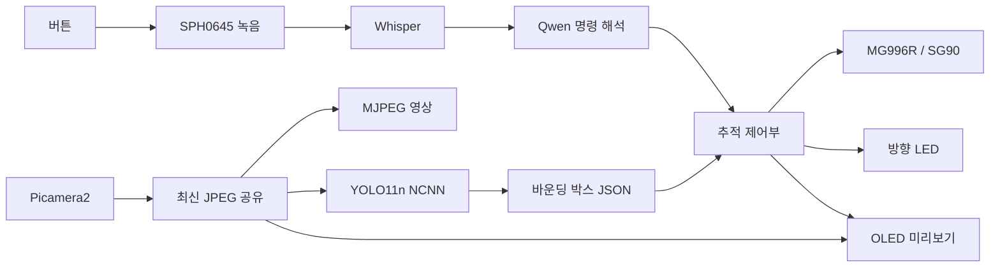

# 구조와 데이터 흐름

## 모듈

| 모듈 | 역할 |
|---|---|
| `stack_service` | 모델·카메라·제어부·버튼 프로세스 시작 순서와 종료 관리 |
| `camera_server` | 카메라를 한 번 열어 웹·YOLO·OLED에 최신 프레임 공유 |
| `camera_orientation` | JPEG 회전으로 모든 소비자의 좌표계 통일 |
| `yolo_detector` | NCNN 추론, 박스 복원, 클래스별 NMS |
| `tracking_controller` | 명령 검증, 최대 박스 선택, 좌표 기반 제어 연결 |
| `motor` | 두 축 오차 보정과 하드웨어 PWM 출력 |
| `button_voice` | 눌림당 녹음 1회, 처리 중 중복 입력 방지 |
| `microphone` | ALSA 녹음, WAV 변환, Whisper 실행, 명령 전달 |
| `command_parser` | Qwen JSON 스키마와 결과 검증 |
| `object_catalog` | COCO 클래스, 한국어 별칭, OLED 약칭 |
| `led`, `oled_preview` | 출력 장치의 상태 표시 |

## 추적 방식

1. 명령의 클래스와 일치하고 신뢰도 0.4 이상인 박스를 모은다.
2. 면적이 가장 큰 박스를 선택한다. 동률이면 신뢰도, 중앙과의 거리를 순서대로 사용한다.
3. `(x1+x2)/2`, `(y1+y2)/2`와 화면 중심의 오차를 각각 계산한다.
4. 허용 오차 밖에서만 속도·프레임 보정 폭·각도 한계를 적용해 목표 각도를 갱신한다.
5. 대상이 없거나 영상이 오래되면 추가 이동을 중단한다. 모터의 현재 목표 자세는 유지한다.

수평 허용 오차는 화면 반폭의 2.5%, 수직은 반높이의 3.5%다. 480×640 영상에서는 약 6px, 11px에 해당한다. 서보 각도는 PWM 환산값이며 실제 축 위치를 읽는 기능은 없다.

## 프로세스와 상태

제어 API와 Qwen은 라파의 loopback에만 열려 있다. 카메라 영상 서버는 8080 포트를 제공한다. 자식 프로세스는 서로 다른 작업 디렉터리에서 실행해 lgpio 알림 파일이 겹치지 않게 한다.

제어 상태는 `idle`, `waiting_for_target`, `tracking`, `centered`, `angle_limit`, `stopped`와 영상·제어 오류 상태로 구성된다. `last_result.latest_command`에는 두 축 중 가장 최근 이동 명령의 모터, 방향, 목표 각도, 발행 시각이 들어간다.

## 리소스

프레임을 큐에 쌓지 않고 최신 JPEG 하나를 공유한다. 기본 카메라 15fps, YOLO 상한 10fps, OLED 상한 3fps다. 카메라 영상은 센서에서 640×480으로 받아 시계 방향 90도 회전한 480×640으로 제공한다.
